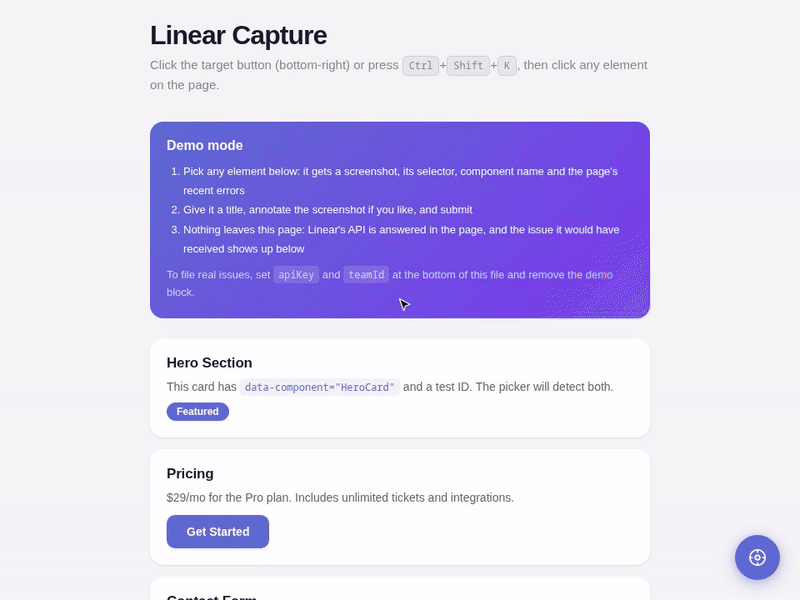

# linear-capture

Point at a bug on the page, annotate it, file it in [Linear](https://linear.app).

[](https://www.npmjs.com/package/@stfrigerio/linear-capture)




A small in-page widget for dev and staging builds. Click the button (or press
<kbd>Ctrl</kbd>/<kbd>⌘</kbd>+<kbd>Shift</kbd>+<kbd>K</kbd>), click the broken
thing, give it a title, and it becomes a Linear issue with everything a
developer needs to find it again:

- **a screenshot** of the element, which you can draw on (pen, arrow, box) before sending
- **where it is:** CSS selector, component name (React, Vue, Svelte, or a
  `data-component` / `data-testid` on it or around it), tag, text, size and position
- **what went wrong around it:** the page's recent console errors, uncaught
  exceptions and failed requests
- **the environment:** URL, viewport, pixel ratio, user agent, time
- **your app's state**, if you put any in `window.__DEBUG_STATE`

Priority and project milestone are picked in the form. Works with mouse, touch
and keyboard (<kbd>Esc</kbd> cancels). No framework required, one script.

## Try it

```bash
git clone https://github.com/stfrigerio/linear-capture
cd linear-capture && npm install && npm run demo
```

Then open <http://localhost:4173/demo/>. The demo answers Linear's API in the
page, so the whole flow runs without an account, and shows the issue Linear
would have received.

## Install

```bash
npm install @stfrigerio/linear-capture
```

```js
import LinearCapture from '@stfrigerio/linear-capture';

if (import.meta.env.DEV) {
  new LinearCapture({ apiKey: 'lin_api_…', teamId: 'TEAM_UUID' }).init();
}
```

Or with a script tag. Configure it first; it only wakes up when the URL has
`?debug=1`:

```html
<script>
  window.__LINEAR_CAPTURE__ = { apiKey: 'lin_api_…', teamId: 'TEAM_UUID' };
</script>
<script src="https://cdn.jsdelivr.net/npm/@stfrigerio/linear-capture@1/dist/linear-capture.min.js"></script>
```

Until it is turned on, importing it changes nothing on the page: console,
`fetch` and `XMLHttpRequest` are only wrapped (to catch errors and failed
requests) from the moment the widget starts.

## Keep your API key off public pages

`apiKey` is a Linear personal API key, and whatever reaches the browser can be
read by anyone who loads the page. Use it as above only on local, dev or
internal builds. Anywhere else, give the widget your own endpoint instead
(`apiProxyUrl`) and keep the key on your server:

```js
// Express (Node 18+). Put it behind your app's own login.
import { ALLOWED_QUERIES } from '@stfrigerio/linear-capture/queries';

app.post('/api/linear', requireLogin, express.json(), async (req, res) => {
  const { query, variables } = req.body;
  // Only the widget's own queries, verbatim: nothing else gets your key.
  if (!ALLOWED_QUERIES.includes(query)) return res.status(403).end();
  const r = await fetch('https://api.linear.app/graphql', {
    method: 'POST',
    headers: { 'Content-Type': 'application/json', Authorization: process.env.LINEAR_API_KEY },
    body: JSON.stringify({ query, variables }),
  });
  res.status(r.status).json(await r.json());
});
```

```js
new LinearCapture({ apiProxyUrl: '/api/linear', teamId: 'TEAM_UUID' }).init();
```

The widget sends its cookies to the proxy, and `proxyHeaders` can add your
own (for example a bearer token).

### Screenshots

Linear stores attachments in a bucket that refuses uploads from browsers on
other sites, so a screenshot uploaded straight from your page usually fails.
The issue is still filed, with a note saying so. To keep the screenshots, add
an upload endpoint (`uploadProxyUrl`): it receives the image as the multipart
field `file` and answers `{ "assetUrl": "…" }`:

```js
import multer from 'multer';
import { FILE_UPLOAD_MUTATION } from '@stfrigerio/linear-capture/queries';

app.post('/api/linear-upload', requireLogin, multer({ limits: { fileSize: 10e6 } }).single('file'), async (req, res) => {
  const { buffer, mimetype, originalname, size } = req.file;
  const r = await fetch('https://api.linear.app/graphql', {
    method: 'POST',
    headers: { 'Content-Type': 'application/json', Authorization: process.env.LINEAR_API_KEY },
    body: JSON.stringify({ query: FILE_UPLOAD_MUTATION, variables: { contentType: mimetype, filename: originalname, size } }),
  });
  const { uploadUrl, assetUrl, headers } = (await r.json()).data.fileUpload.uploadFile;
  await fetch(uploadUrl, {
    method: 'PUT',
    headers: { 'Content-Type': mimetype, ...Object.fromEntries(headers.map(h => [h.key, h.value])) },
    body: buffer,
  });
  res.json({ assetUrl });
});
```

## Options

| option            | default   | what it does |
|-------------------|-----------|--------------|
| `teamId`          | required  | the Linear team new issues go to |
| `apiKey`          |           | Linear personal API key (dev builds only, see above) |
| `apiProxyUrl`     |           | your endpoint that forwards the widget's queries to Linear; replaces `apiKey` |
| `uploadProxyUrl`  |           | your endpoint that uploads screenshots to Linear |
| `proxyHeaders`    |           | headers for both proxies: an object, or a function returning one (called on every request) |
| `projectId`       |           | file issues into this project, and offer its milestones in the form |
| `labelIds`        | `[]`      | labels every issue gets |
| `defaultPriority` | `0`       | preselected priority: 0 none, 1 urgent, 2 high, 3 medium, 4 low |
| `flagParam`, `flagValue` | `debug`, `1` | the URL parameter that turns the script-tag version on |

## What goes into the issue

The issue body is Markdown, editable in the form's *Context* section before
sending. Query parameters that look like secrets (`token`, `api_key`,
`password`, `session`, `code`, `signature`, …) have their values replaced with
`REDACTED` in every URL it contains. Console messages and your
`__DEBUG_STATE` are sent as they are, so keep secrets out of them.

Screenshots are taken with [html2canvas](https://html2canvas.hertzen.com/),
loaded from jsDelivr the first time it's needed. If your Content Security
Policy blocks that, load it yourself first: the widget uses `window.html2canvas`
when it's there.

## API

```js
const lc = new LinearCapture(options);
lc.init();      // adds the button and the shortcut
lc.destroy();   // removes them again
```

## Development

```bash
npm run dev     # rebuild dist/ on every change
npm run demo    # serve the demo at http://localhost:4173/demo/
npm run build
```

Releases: `npm run release` bumps the minor version and pushes its tag; the
[publish workflow](.github/workflows/publish.yml) then publishes it to npm
from GitHub Actions, with [trusted publishing](https://docs.npmjs.com/trusted-publishers)
(no npm token anywhere) and provenance.

## License

MIT
